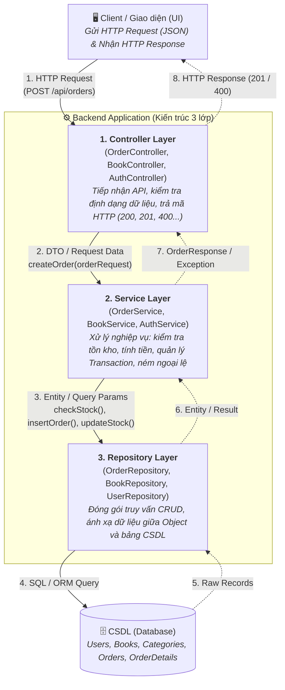

# Sơ đồ Kiến trúc Hệ thống & Tổ chức Mã nguồn 3 Lớp

> **Dự án:** Website Thương mại điện tử bán sách (Book Store) – Nhóm HQHKN  
> **Vị trí lưu trữ:** `docs/architecture.md`

---

## 1. Sơ đồ kiến trúc tổng quan (Controller – Service – Repository)

Hệ thống được thiết kế theo **kiến trúc phân tầng (Layered Architecture)** gồm 3 lớp chính ở phía Backend. Luồng phụ thuộc tuân thủ nguyên tắc **một chiều từ trên xuống dưới**: tầng trên chỉ giao tiếp với tầng liền kề bên dưới, tuyệt đối không gọi tắt từ `Controller` xuống `Repository` hay truy vấn trực tiếp `CSDL`.



---

## 2. Nguyên tắc tách biệt trách nhiệm giữa các lớp

| Lớp (Layer) | Nhiệm vụ được phép | Điều cấm (Vi phạm kiến trúc) |
| :--- | :--- | :--- |
| **1. Controller** | Tiếp nhận HTTP Request, trích xuất `body`/`params`/`query`, gọi `Service`, bắt ngoại lệ và trả về HTTP Status Code (`200`, `201`, `400`, `500`...). | Viết logic xử lý nghiệp vụ, tính toán giá/tồn kho, viết câu lệnh SQL/ORM, gọi trực tiếp `Repository`. |
| **2. Service** | Thực thi quy tắc nghiệp vụ cốt lõi, điều phối nhiều `Repository`, quản lý Database Transaction, ném ngoại lệ nghiệp vụ (`OutOfStockException`). | Truy cập trực tiếp đối tượng `req`/`res` của HTTP, viết trực tiếp câu truy vấn SQL. |
| **3. Repository** | Thực hiện các thao tác đọc/ghi dữ liệu (`SELECT`, `INSERT`, `UPDATE`, `DELETE`) với CSDL. | Chứa logic kiểm tra điều kiện nghiệp vụ (như kiểm tra hết hàng hay kiểm tra quyền truy cập). |

---

## 3. Cấu trúc thư mục chuẩn của dự án

```text
DoAnChuyenNganh/
├── docs/                           # Tài liệu phân tích, thiết kế & biên bản họp
│   ├── de-cuong.md
│   ├── architecture.md
│   ├── sequence-diagram.png
│   └── meetings/
│       ├── 01.md
│       ├── 02.md
│       └── 03.md
├── ai-logs/                        # Nhật ký sử dụng công cụ AI hỗ trợ
└── src/                            # Mã nguồn ứng dụng Backend
    ├── config/                     # Cấu hình kết nối CSDL, biến môi trường
    │   └── database.js
    ├── controllers/                # Lớp 1: Tiếp nhận API & phản hồi HTTP
    │   ├── OrderController.js
    │   └── BookController.js
    ├── services/                   # Lớp 2: Xử lý logic nghiệp vụ
    │   ├── OrderService.js
    │   └── BookService.js
    ├── repositories/               # Lớp 3: Truy xuất dữ liệu CSDL
    │   ├── OrderRepository.js
    │   └── BookRepository.js
    ├── models/                     # Định nghĩa thực thể (Entity / Schema)
    │   ├── Order.js
    │   └── Book.js
    ├── exceptions/                 # Các lớp ngoại lệ nghiệp vụ tùy chỉnh
    │   └── OutOfStockException.js
    └── routes/                     # Định tuyến endpoint vào Controller
        └── orderRoutes.js
```

---

## 4. Mã nguồn tổ chức chuẩn 3 lớp (Nghiệp vụ Đặt hàng)

Đoạn mã dưới đây hiện thực hóa đúng luồng tương tác trong biểu đồ tuần tự `docs/sequence-diagram.png`.

### 4.1. Ngoại lệ nghiệp vụ (`src/exceptions/OutOfStockException.js`)

```javascript
class OutOfStockException extends Error {
  constructor(message) {
    super(message);
    this.name = "OutOfStockException";
    this.statusCode = 400;
  }
}

module.exports = OutOfStockException;
```

### 4.2. Lớp 3 – Repository (`src/repositories/BookRepository.js` & `OrderRepository.js`)

```javascript
// src/repositories/BookRepository.js
const db = require("../config/database");

class BookRepository {
  // Kiểm tra số lượng tồn kho theo danh sách mã sách
  async findStocksByIds(productIds) {
    const query = `SELECT id, title, price, stock_quantity FROM books WHERE id IN (?)`;
    const [rows] = await db.query(query, [productIds]);
    return rows;
  }

  // Trừ số lượng tồn kho khi đặt hàng thành công
  async decreaseStock(productId, quantity, connection = db) {
    const query = `
      UPDATE books 
      SET stock_quantity = stock_quantity - ? 
      WHERE id = ?
    `;
    const [result] = await connection.query(query, [quantity, productId]);
    return result.affectedRows > 0;
  }
}

module.exports = new BookRepository();
```

```javascript
// src/repositories/OrderRepository.js
const db = require("../config/database");

class OrderRepository {
  // Lưu thông tin đơn hàng và chi tiết đơn hàng vào CSDL
  async insertOrder(orderData, connection = db) {
    const orderQuery = `
      INSERT INTO orders (user_id, total_amount, shipping_address, status) 
      VALUES (?, ?, ?, 'PENDING')
    `;
    const [orderResult] = await connection.query(orderQuery, [
      orderData.userId,
      orderData.totalAmount,
      orderData.shippingAddress,
    ]);

    const orderId = orderResult.insertId;

    for (const item of orderData.items) {
      const detailQuery = `
        INSERT INTO order_details (order_id, book_id, quantity, price_at_order) 
        VALUES (?, ?, ?, ?)
      `;
      await connection.query(detailQuery, [
        orderId,
        item.productId,
        item.quantity,
        item.unitPrice,
      ]);
    }

    return orderId;
  }
}

module.exports = new OrderRepository();
```

### 4.3. Lớp 2 – Service (`src/services/OrderService.js`)

```javascript
// src/services/OrderService.js
const db = require("../config/database");
const bookRepository = require("../repositories/BookRepository");
const orderRepository = require("../repositories/OrderRepository");
const OutOfStockException = require("../exceptions/OutOfStockException");

class OrderService {
  async createOrder(orderRequest) {
    const { userId, shippingAddress, items } = orderRequest;

    if (!items || items.length === 0) {
      throw new OutOfStockException("Danh sách sản phẩm đặt hàng không được rỗng.");
    }

    // 1. Gọi Repository lấy thông tin tồn kho
    const productIds = items.map((item) => item.productId);
    const booksInDb = await bookRepository.findStocksByIds(productIds);
    const bookMap = new Map(booksInDb.map((b) => [b.id, b]));

    let totalAmount = 0;
    const enrichedItems = [];

    // 2. Kiểm tra điều kiện tồn kho & tính tổng tiền
    for (const item of items) {
      const book = bookMap.get(item.productId);
      if (!book || book.stock_quantity < item.quantity) {
        throw new OutOfStockException(
          `Sản phẩm ID=${item.productId} không đủ số lượng tồn kho.`
        );
      }

      totalAmount += book.price * item.quantity;
      enrichedItems.push({
        productId: item.productId,
        quantity: item.quantity,
        unitPrice: book.price,
      });
    }

    // 3. Lưu đơn hàng & cập nhật tồn kho trong cùng 1 Database Transaction
    const connection = await db.getConnection();
    try {
      await connection.beginTransaction();

      const orderId = await orderRepository.insertOrder(
        { userId, shippingAddress, totalAmount, items: enrichedItems },
        connection
      );

      for (const item of enrichedItems) {
        await bookRepository.decreaseStock(item.productId, item.quantity, connection);
      }

      await connection.commit();

      return {
        orderId,
        totalAmount,
        status: "PENDING",
        message: "Đặt hàng thành công",
      };
    } catch (error) {
      await connection.rollback();
      throw error;
    } finally {
      connection.release();
    }
  }
}

module.exports = new OrderService();
```

### 4.4. Lớp 1 – Controller (`src/controllers/OrderController.js`)

```javascript
// src/controllers/OrderController.js
const orderService = require("../services/OrderService");
const OutOfStockException = require("../exceptions/OutOfStockException");

class OrderController {
  async postOrder(req, res) {
    try {
      const orderRequest = req.body;
      const orderResponse = await orderService.createOrder(orderRequest);

      return res.status(201).json({
        success: true,
        data: orderResponse,
      });
    } catch (error) {
      if (error instanceof OutOfStockException) {
        return res.status(400).json({
          success: false,
          message: error.message,
        });
      }

      return res.status(500).json({
        success: false,
        message: "Lỗi hệ thống khi xử lý đơn hàng.",
      });
    }
  }
}

module.exports = new OrderController();
```

### 4.5. Định tuyến (`src/routes/orderRoutes.js`)

```javascript
const express = require("express");
const router = express.Router();
const orderController = require("../controllers/OrderController");

router.post("/api/orders", (req, res) => orderController.postOrder(req, res));

module.exports = router;
```