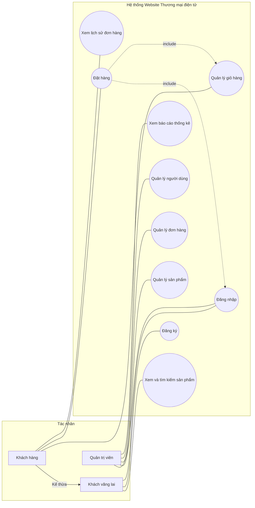

# Tài liệu Sơ đồ Use Case & Đặc tả Chức năng

## 1. Sơ đồ Use Case Diagram (Tổng quan)

### Sơ đồ Mermaid (Nguồn)

---

## 2. Đặc tả chi tiết các Use Case chính

### 2.1. Use Case 1: Đăng nhập (Login)

| Mục | Nội dung |
| :--- | :--- |
| **Mã Use Case** | UC-01 |
| **Tên Use Case** | Đăng nhập |
| **Tác nhân** | Khách hàng, Quản trị viên |
| **Mô tả** | Người dùng xác thực thông tin tài khoản để truy cập các tính năng cá nhân hoặc quản trị trên hệ thống. |
| **Tiền điều kiện** | Người dùng đã có tài khoản trên hệ thống và đang ở trang Đăng nhập. |
| **Hậu điều kiện** | Hệ thống xác thực thành công, phân quyền người dùng và chuyển hướng về trang tương ứng (Trang chủ / Trang Quản trị). |

#### Luồng sự kiện chính (Basic Flow)
1. Người dùng truy cập vào trang Đăng nhập.
2. Hệ thống hiển thị biểu mẫu đăng nhập (Yêu cầu nhập Email/Tên đăng nhập và Mật khẩu).
3. Người dùng nhập Email/Tên đăng nhập và Mật khẩu, sau đó nhấn nút **"Đăng nhập"**.
4. Hệ thống kiểm tra và xác thực thông tin đăng nhập trong CSDL.
5. Hệ thống xác thực thành công, tạo phiên đăng nhập (session/token) và chuyển hướng người dùng:
   - **Khách hàng:** Chuyển về trang trước đó hoặc Trang chủ.
   - **Quản trị viên:** Chuyển về Dashboard Quản trị.

#### Luồng sự kiện phụ / Ngoại lệ (Alternative / Exception Flows)
* **4a. Thông tin đăng nhập không hợp lệ (Sai Email/Mật khẩu):**
  1. Hệ thống phát hiện Email hoặc Mật khẩu không chính xác.
  2. Hệ thống hiển thị thông báo lỗi: *"Tên đăng nhập hoặc mật khẩu không chính xác."*
  3. Hệ thống cho phép người dùng nhập lại (Quay lại bước 3).
* **4b. Tài khoản bị khóa:**
  1. Hệ thống kiểm tra thấy trạng thái tài khoản đang ở mức `Disabled` / `Blocked`.
  2. Hệ thống hiển thị thông báo: *"Tài khoản của bạn đã bị khóa. Vui lòng liên hệ hỗ trợ."*
  3. Use case kết thúc.
* **4c. Quên mật khẩu:**
  1. Tại bước 3, người dùng nhấn nút **"Quên mật khẩu"**.
  2. Hệ thống chuyển hướng sang luồng khôi phục mật khẩu qua Email.

---

### 2.2. Use Case 2: Đặt hàng (Place Order)

| Mục | Nội dung |
| :--- | :--- |
| **Mã Use Case** | UC-02 |
| **Tên Use Case** | Đặt hàng |
| **Tác nhân** | Khách hàng |
| **Mô tả** | Khách hàng thực hiện quy trình thanh toán cho các sản phẩm đã chọn trong giỏ hàng. |
| **Tiền điều kiện** | Khách hàng đã đăng nhập và trong giỏ hàng có ít nhất 01 sản phẩm. |
| **Hậu điều kiện** | Đơn hàng được ghi nhận vào hệ thống với trạng thái "Chờ xử lý", số lượng kho của sản phẩm giảm tương ứng, giỏ hàng được làm sạch. |

#### Luồng sự kiện chính (Basic Flow)
1. Khách hàng truy cập vào trang Giỏ hàng và nhấn nút **"Thanh toán"** (Checkout).
2. Hệ thống hiển thị biểu mẫu Đặt hàng gồm:
   - Thông tin người nhận (Họ tên, Số điện thoại, Địa chỉ giao hàng).
   - Danh sách sản phẩm & tổng tiền.
   - Các phương thức thanh toán (COD, Chuyển khoản, Ví điện tử).
3. Khách hàng kiểm tra/chỉnh sửa thông tin giao hàng và lựa chọn phương thức thanh toán.
4. Khách hàng nhấn nút **"Xác nhận đặt hàng"**.
5. Hệ thống kiểm tra tồn kho của từng sản phẩm trong đơn hàng.
6. Hệ thống khởi tạo đơn hàng mới, cập nhật số lượng tồn kho và gửi email xác nhận cho Khách hàng.
7. Hệ thống xóa các sản phẩm đã mua khỏi giỏ hàng và hiển thị trang **"Đặt hàng thành công"** kèm mã đơn hàng.

#### Luồng sự kiện phụ / Ngoại lệ (Alternative / Exception Flows)
* **1a. Khách hàng chưa đăng nhập:**
  1. Hệ thống yêu cầu Khách hàng đăng nhập (gọi **UC-01: Đăng nhập**).
  2. Sau khi đăng nhập thành công, hệ thống chuyển tiếp Khách hàng trở lại bước Thanh toán.
* **5a. Sản phẩm trong giỏ hàng hết hàng hoặc không đủ số lượng:**
  1. Hệ thống phát hiện số lượng tồn kho không đủ đáp ứng.
  2. Hệ thống thông báo lỗi: *"Sản phẩm [Tên sản phẩm] chỉ còn [X] mục trong kho. Vui lòng cập nhật lại giỏ hàng."*
  3. Hệ thống quay lại trang Giỏ hàng để Khách hàng điều chỉnh số lượng.
* **6a. Thanh toán trực tuyến thất bại (nếu chọn Chuyển khoản/Ví điện tử):**
  1. Cổng thanh toán trả về trạng thái giao dịch thất bại.
  2. Hệ thống lưu đơn hàng ở trạng thái *"Chờ thanh toán"*.
  3. Hệ thống hiển thị thông báo lỗi và cung cấp tùy chọn cho phép Khách hàng thử lại hoặc đổi phương thức thanh toán.

---

### 2.3. Use Case 3: Quản lý sản phẩm (Manage Products)

| Mục | Nội dung |
| :--- | :--- |
| **Mã Use Case** | UC-03 |
| **Tên Use Case** | Quản lý sản phẩm |
| **Tác nhân** | Quản trị viên |
| **Mô tả** | Cho phép Quản trị viên thực hiện các thao tác Xem, Thêm, Sửa, Xóa thông tin sản phẩm trong hệ thống. |
| **Tiền điều kiện** | Quản trị viên đã đăng nhập thành công và truy cập vào trang Quản lý sản phẩm. |
| **Hậu điều kiện** | Cơ sở dữ liệu sản phẩm được cập nhật chính xác theo thao tác thực hiện. |

#### Luồng sự kiện chính (Basic Flow)
1. Quản trị viên truy cập vào danh mục **Quản lý sản phẩm**.
2. Hệ thống tải và hiển thị danh sách sản phẩm (gồm hình ảnh, tên, giá, số lượng tồn kho, danh mục, trạng thái).
3. Quản trị viên lựa chọn một trong các thao tác:

   * **Trường hợp A: Thêm sản phẩm mới**
     1. Quản trị viên nhấn nút **"Thêm mới"**.
     2. Hệ thống hiển thị form nhập thông tin sản phẩm.
     3. Quản trị viên nhập thông tin (Tên, Giá, Số lượng, Danh mục, Mô tả, Hình ảnh) và nhấn **"Lưu"**.
     4. Hệ thống kiểm tra dữ liệu, lưu sản phẩm mới vào CSDL và cập nhật danh sách.

   * **Trường hợp B: Cập nhật thông tin sản phẩm**
     1. Quản trị viên chọn sản phẩm cần chỉnh sửa và nhấn nút **"Chỉnh sửa"**.
     2. Hệ thống hiển thị form điền sẵn thông tin hiện tại của sản phẩm.
     3. Quản trị viên sửa đổi các thông tin cần thiết và nhấn **"Cập nhật"**.
     4. Hệ thống lưu các thay đổi vào CSDL và thông báo thành công.

   * **Trường hợp C: Xóa / Ẩn sản phẩm**
     1. Quản trị viên chọn sản phẩm và nhấn nút **"Xóa"**.
     2. Hệ thống hiển thị hộp thoại xác nhận: *"Bạn có chắc chắn muốn xóa sản phẩm này?"*.
     3. Quản trị viên nhấn **"Xác nhận"**.
     4. Hệ thống đổi trạng thái sản phẩm sang *"Đã xóa/Ẩn"* (Soft delete) và cập nhật giao diện.

#### Luồng sự kiện phụ / Ngoại lệ (Alternative / Exception Flows)
* **A3a / B3a. Dữ liệu nhập không hợp lệ (Bỏ trống trường bắt buộc, Giá/Số lượng âm):**
  1. Hệ thống kiểm tra dữ liệu không vượt qua tính hợp lệ (Validation).
  2. Hệ thống đánh dấu đỏ các ô bị lỗi và hiển thị thông báo cụ thể (ví dụ: *"Giá sản phẩm phải lớn hơn 0"*).
  3. Quản trị viên chỉnh sửa dữ liệu lỗi và bấm lưu lại.
* **C3a. Xóa sản phẩm đang nằm trong đơn hàng đang xử lý:**
  1. Hệ thống kiểm tra thấy sản phẩm gắn với các đơn hàng chưa hoàn tất.
  2. Hệ thống từ chối xóa vĩnh viễn và gợi ý chuyển trạng thái sản phẩm sang *"Ngừng kinh doanh"* thay vì xóa.
---

### 2.4. Use Case 4: Đăng ký tài khoản (Register)

| Mục | Nội dung |
| :--- | :--- |
| **Mã Use Case** | UC-04 |
| **Tên Use Case** | Đăng ký tài khoản |
| **Tác nhân** | Khách vãng lai |
| **Mô tả** | Người dùng mới tạo tài khoản thành viên để có thể đặt mua sách và quản lý đơn hàng trên hệ thống. |
| **Tiền điều kiện** | Người dùng chưa đăng nhập và đang ở trang Đăng ký. |
| **Hậu điều kiện** | Tài khoản mới được lưu vào CSDL với mật khẩu đã mã hóa và vai trò mặc định là `Customer`. |

#### Luồng sự kiện chính (Basic Flow)
1. Người dùng truy cập vào trang Đăng ký.
2. Hệ thống hiển thị biểu mẫu đăng ký (Họ tên, Email, Số điện thoại, Mật khẩu, Xác nhận mật khẩu).
3. Người dùng điền đầy đủ thông tin và nhấn nút **"Đăng ký"**.
4. Hệ thống kiểm tra định dạng dữ liệu và đối chiếu Email trong CSDL để đảm bảo chưa tồn tại.
5. Hệ thống mã hóa mật khẩu, tạo tài khoản mới và hiển thị thông báo đăng ký thành công.
6. Hệ thống tự động đăng nhập hoặc chuyển hướng người dùng sang trang Đăng nhập (**UC-01**).

#### Luồng sự kiện phụ / Ngoại lệ (Alternative / Exception Flows)
* **4a. Email đã được sử dụng:**
  1. Hệ thống phát hiện Email đã tồn tại trong CSDL.
  2. Hệ thống thông báo lỗi: *"Email này đã được đăng ký. Vui lòng sử dụng email khác hoặc đăng nhập."*
  3. Quay lại bước 3.
* **4b. Dữ liệu nhập không hợp lệ (Sai định dạng email, mật khẩu quá ngắn hoặc xác nhận mật khẩu không khớp):**
  1. Hệ thống đánh dấu các trường nhập sai và hiển thị thông báo hướng dẫn sửa.
  2. Quay lại bước 3.

---

### 2.5. Use Case 5: Quản lý thông tin cá nhân (Manage Profile)

| Mục | Nội dung |
| :--- | :--- |
| **Mã Use Case** | UC-05 |
| **Tên Use Case** | Quản lý thông tin cá nhân |
| **Tác nhân** | Khách hàng |
| **Mô tả** | Cho phép Khách hàng xem, cập nhật thông tin liên hệ giao hàng và thay đổi mật khẩu tài khoản. |
| **Tiền điều kiện** | Khách hàng đã đăng nhập thành công vào hệ thống. |
| **Hậu điều kiện** | Thông tin cá nhân hoặc mật khẩu mới được cập nhật chính xác vào CSDL. |

#### Luồng sự kiện chính (Basic Flow)
1. Khách hàng truy cập vào trang **Hồ sơ cá nhân**.
2. Hệ thống tải và hiển thị thông tin hiện tại (Họ tên, Email, Số điện thoại, Địa chỉ giao hàng).
3. Khách hàng chỉnh sửa Họ tên, Số điện thoại, Địa chỉ và nhấn **"Lưu thay đổi"**.
4. Hệ thống kiểm tra tính hợp lệ của dữ liệu và cập nhật vào CSDL.
5. Hệ thống hiển thị thông báo: *"Cập nhật thông tin thành công."*

#### Luồng sự kiện phụ / Ngoại lệ (Alternative / Exception Flows)
* **3a. Khách hàng chọn Đổi mật khẩu:**
  1. Khách hàng chuyển sang tab **"Đổi mật khẩu"**, nhập Mật khẩu hiện tại, Mật khẩu mới và Xác nhận mật khẩu mới.
  2. Hệ thống xác thực Mật khẩu hiện tại; nếu khớp sẽ mã hóa và lưu Mật khẩu mới.
  3. Nếu Mật khẩu hiện tại sai, hệ thống báo lỗi: *"Mật khẩu hiện tại không chính xác."*

---

### 2.6. Use Case 6: Xem danh sách và Chi tiết sách (View Books)

| Mục | Nội dung |
| :--- | :--- |
| **Mã Use Case** | UC-06 |
| **Tên Use Case** | Xem danh sách và Chi tiết sách |
| **Tác nhân** | Khách vãng lai, Khách hàng |
| **Mô tả** | Hiển thị danh sách các tựa sách của cửa hàng và thông tin mô tả chi tiết của từng cuốn sách trên cả máy tính và điện thoại. |
| **Tiền điều kiện** | Hệ thống hoạt động bình thường, người dùng truy cập vào website cửa hàng sách. |
| **Hậu điều kiện** | Người dùng xem được danh sách sách và thông tin chi tiết của cuốn sách đã chọn. |

#### Luồng sự kiện chính (Basic Flow)
1. Người dùng truy cập vào Trang chủ hoặc trang Danh mục sản phẩm.
2. Hệ thống hiển thị danh sách sách (ảnh bìa, tên sách, tác giả, giá bán) theo dạng lưới có phân trang và tương thích với màn hình điện thoại.
3. Người dùng nhấn chọn vào một cuốn sách bất kỳ.
4. Hệ thống truy vấn CSDL và mở trang **Chi tiết sách** hiển thị đầy đủ: Tên sách, Tác giả, Nhà xuất bản, Thể loại, Giá bán, Số lượng tồn kho và Mô tả nội dung.

#### Luồng sự kiện phụ / Ngoại lệ (Alternative / Exception Flows)
* **4a. Sách đã hết hàng (`stock = 0`):**
  1. Hệ thống vẫn hiển thị thông tin chi tiết của sách nhưng gắn nhãn **"Hết hàng"**.
  2. Nút *"Thêm vào giỏ hàng"* bị vô hiệu hóa.

---

### 2.7. Use Case 7: Tìm kiếm và Lọc sách (Search & Filter Books)

| Mục | Nội dung |
| :--- | :--- |
| **Mã Use Case** | UC-07 |
| **Tên Use Case** | Tìm kiếm và Lọc sách |
| **Tác nhân** | Khách vãng lai, Khách hàng |
| **Mô tả** | Hỗ trợ người mua tra cứu nhanh tựa sách mong muốn theo từ khóa hoặc lọc theo thể loại, mức giá. |
| **Tiền điều kiện** | Người dùng đang ở giao diện hiển thị thanh tìm kiếm hoặc bộ lọc của website. |
| **Hậu điều kiện** | Danh sách sách phù hợp với tiêu chí tìm kiếm/lọc được hiển thị trên màn hình. |

#### Luồng sự kiện chính (Basic Flow)
1. Người dùng nhập từ khóa (Tên sách hoặc Tên tác giả) vào thanh tìm kiếm, hoặc chọn bộ lọc (Thể loại sách, Khoảng giá, Sắp xếp theo giá).
2. Người dùng nhấn nút **"Tìm kiếm"** hoặc áp dụng bộ lọc.
3. Hệ thống truy vấn CSDL theo các điều kiện đã chọn.
4. Hệ thống hiển thị danh sách các cuốn sách khớp với kết quả tìm kiếm.

#### Luồng sự kiện phụ / Ngoại lệ (Alternative / Exception Flows)
* **4a. Không tìm thấy kết quả phù hợp:**
  1. Hệ thống trả về danh sách rỗng.
  2. Hệ thống hiển thị thông báo: *"Không tìm thấy cuốn sách nào phù hợp với từ khóa của bạn."*

---

### 2.8. Use Case 8: Quản lý giỏ hàng (Manage Cart)

| Mục | Nội dung |
| :--- | :--- |
| **Mã Use Case** | UC-08 |
| **Tên Use Case** | Quản lý giỏ hàng |
| **Tác nhân** | Khách vãng lai, Khách hàng |
| **Mô tả** | Cho phép người dùng thêm sách vào giỏ, cập nhật số lượng hoặc xóa sản phẩm khỏi giỏ trước khi tiến hành đặt hàng. |
| **Tiền điều kiện** | Sách được thêm vào giỏ đang ở trạng thái còn hàng (`stock > 0`). |
| **Hậu điều kiện** | Trạng thái giỏ hàng và tổng tiền tạm tính được cập nhật chính xác. |

#### Luồng sự kiện chính (Basic Flow)
1. Tại trang danh sách hoặc chi tiết sách, người dùng nhấn nút **"Thêm vào giỏ hàng"**.
2. Hệ thống thêm sản phẩm vào giỏ hàng (Session/LocalStorage hoặc CSDL) và cập nhật biểu tượng số lượng trên thanh điều hướng.
3. Người dùng truy cập vào trang **Giỏ hàng**.
4. Hệ thống hiển thị danh sách sách trong giỏ gồm: Hình ảnh, Tên sách, Đơn giá, Số lượng, Thành tiền và Tổng tiền tạm tính.
5. Người dùng thay đổi số lượng (tăng/giảm) hoặc nhấn nút **"Xóa"** sản phẩm; hệ thống tự động tính lại tổng tiền.

#### Luồng sự kiện phụ / Ngoại lệ (Alternative / Exception Flows)
* **5a. Số lượng nhập vượt quá số lượng tồn kho:**
  1. Hệ thống kiểm tra thấy số lượng khách chọn lớn hơn `stock` hiện tại.
  2. Hệ thống tự động điều chỉnh về mức tối đa cho phép và thông báo: *"Số lượng sách trong kho chỉ còn [X] cuốn."*

---

### 2.9. Use Case 9: Theo dõi và Hủy đơn hàng (Track & Cancel Order)

| Mục | Nội dung |
| :--- | :--- |
| **Mã Use Case** | UC-09 |
| **Tên Use Case** | Theo dõi và Hủy đơn hàng |
| **Tác nhân** | Khách hàng |
| **Mô tả** | Khách hàng xem lịch sử đặt hàng, kiểm tra trạng thái giao nhận và hủy đơn hàng khi cửa hàng chưa xác nhận. |
| **Tiền điều kiện** | Khách hàng đã đăng nhập và đã từng tạo ít nhất 01 đơn đặt hàng. |
| **Hậu điều kiện** | Khách hàng nắm được trạng thái đơn hàng; nếu hủy đơn hợp lệ, trạng thái đơn chuyển sang `CANCELLED`. |

#### Luồng sự kiện chính (Basic Flow)
1. Khách hàng truy cập vào mục **Đơn hàng của tôi**.
2. Hệ thống tải danh sách các đơn hàng của khách hàng (Mã đơn, Ngày đặt, Tổng tiền, Phương thức COD, Trạng thái).
3. Khách hàng nhấn vào một đơn hàng để xem chi tiết (Danh sách sách đã mua, đơn giá lúc mua, địa chỉ nhận hàng).
4. Với đơn hàng đang ở trạng thái **Chờ xác nhận (`PENDING`)**, khách hàng nhấn nút **"Hủy đơn hàng"**.
5. Hệ thống hiển thị hộp thoại xác nhận, sau khi khách hàng đồng ý thì cập nhật trạng thái đơn sang **Đã hủy (`CANCELLED`)**.

#### Luồng sự kiện phụ / Ngoại lệ (Alternative / Exception Flows)
* **4a. Đơn hàng đã được duyệt hoặc đang giao (`CONFIRMED` / `SHIPPING`):**
  1. Hệ thống ẩn hoặc vô hiệu hóa nút **"Hủy đơn hàng"**.
  2. Khách hàng chỉ có thể xem thông tin chi tiết đơn hàng.

---

### 2.10. Use Case 10: Quản lý thể loại sách (Manage Categories)

| Mục | Nội dung |
| :--- | :--- |
| **Mã Use Case** | UC-10 |
| **Tên Use Case** | Quản lý thể loại sách |
| **Tác nhân** | Quản trị viên |
| **Mô tả** | Cho phép Quản trị viên xem, thêm mới, chỉnh sửa và xóa các danh mục/thể loại sách trên hệ thống. |
| **Tiền điều kiện** | Quản trị viên đã đăng nhập với quyền `ADMIN`. |
| **Hậu điều kiện** | Danh mục thể loại sách trong CSDL được cập nhật chính xác. |

#### Luồng sự kiện chính (Basic Flow)
1. Quản trị viên truy cập vào trang **Quản lý thể loại**.
2. Hệ thống hiển thị danh sách các thể loại hiện có và số lượng đầu sách thuộc mỗi thể loại.
3. Quản trị viên thực hiện thao tác:
   * **Thêm mới:** Nhập tên thể loại, mô tả và nhấn **"Lưu"**.
   * **Chỉnh sửa:** Chọn thể loại cần sửa, cập nhật tên/mô tả và nhấn **"Cập nhật"**.
   * **Xóa:** Chọn thể loại không sử dụng, nhấn **"Xóa"** và xác nhận.
4. Hệ thống kiểm tra tính hợp lệ, cập nhật CSDL và thông báo thành công.

#### Luồng sự kiện phụ / Ngoại lệ (Alternative / Exception Flows)
* **3a. Tên thể loại bị trùng lặp hoặc bỏ trống:**
  1. Hệ thống từ chối lưu và hiển thị thông báo: *"Tên thể loại không được để trống hoặc đã tồn tại."*
* **3b. Xóa thể loại đang chứa sách:**
  1. Hệ thống phát hiện vẫn còn sản phẩm sách liên kết với thể loại này.
  2. Hệ thống ngăn chặn thao tác xóa và thông báo: *"Không thể xóa thể loại đang có sách. Vui lòng chuyển sách sang thể loại khác trước."*

---

### 2.11. Use Case 11: Quản lý đơn hàng (Manage Orders)

| Mục | Nội dung |
| :--- | :--- |
| **Mã Use Case** | UC-11 |
| **Tên Use Case** | Quản lý đơn hàng |
| **Tác nhân** | Quản trị viên |
| **Mô tả** | Quản trị viên kiểm tra đơn đặt hàng trực tuyến, duyệt đơn, cập nhật tiến độ giao hàng và xác nhận thu tiền COD. |
| **Tiền điều kiện** | Quản trị viên đã đăng nhập vào trang Quản trị. |
| **Hậu điều kiện** | Trạng thái đơn hàng, trạng thái thanh toán COD và số lượng tồn kho được cập nhật đồng bộ. |

#### Luồng sự kiện chính (Basic Flow)
1. Quản trị viên truy cập vào mục **Quản lý đơn hàng**.
2. Hệ thống hiển thị danh sách đơn hàng (có thể lọc theo trạng thái: `PENDING`, `CONFIRMED`, `SHIPPING`, `COMPLETED`, `CANCELLED`, `FAILED`).
3. Quản trị viên chọn một đơn hàng để xem chi tiết thông tin khách nhận và danh sách sách đặt mua.
4. Quản trị viên cập nhật trạng thái đơn hàng theo quy trình:
   * **Duyệt đơn (`PENDING` $\rightarrow$ `CONFIRMED`):** Xác nhận đơn hợp lệ, hệ thống trừ số lượng tồn kho tương ứng.
   * **Giao hàng (`CONFIRMED` $\rightarrow$ `SHIPPING`):** Xác nhận bàn giao cho đơn vị vận chuyển.
   * **Hoàn thành (`SHIPPING` $\rightarrow$ `COMPLETED`):** Xác nhận khách đã nhận sách và thanh toán tiền mặt COD; hệ thống chuyển trạng thái thanh toán sang `PAID`.
5. Hệ thống lưu thay đổi và thông báo cập nhật thành công.

#### Luồng sự kiện phụ / Ngoại lệ (Alternative / Exception Flows)
* **4a. Hủy đơn đã duyệt hoặc Giao thất bại (`CONFIRMED` $\rightarrow$ `CANCELLED` hoặc `SHIPPING` $\rightarrow$ `FAILED`):**
  1. Quản trị viên chọn trạng thái hủy hoặc giao thất bại.
  2. Hệ thống tự động cộng hoàn lại số lượng sách của đơn hàng đó vào lại kho (`stock`).

---

### 2.12. Use Case 12: Quản lý khách hàng và Thống kê cơ bản (Manage Users & Basic Statistics)

| Mục | Nội dung |
| :--- | :--- |
| **Mã Use Case** | UC-12 |
| **Tên Use Case** | Quản lý khách hàng và Thống kê cơ bản |
| **Tác nhân** | Quản trị viên |
| **Mô tả** | Quản trị viên theo dõi danh sách tài khoản khách hàng (khóa/mở khóa tài khoản) và xem số liệu thống kê tổng quan doanh thu, đơn hàng. |
| **Tiền điều kiện** | Quản trị viên đã đăng nhập vào trang Quản trị. |
| **Hậu điều kiện** | Trạng thái tài khoản khách hàng được cập nhật hoặc báo cáo thống kê được hiển thị chính xác. |

#### Luồng sự kiện chính (Basic Flow)
1. **Xem thống kê tổng quan:**
   1. Khi truy cập **Dashboard Quản trị**, hệ thống tổng hợp và hiển thị các chỉ số: Tổng số sản phẩm sách, Tổng số khách hàng, Tổng số đơn hàng theo từng trạng thái và Tổng doanh thu (tính từ các đơn `COMPLETED`).
2. **Quản lý tài khoản khách hàng:**
   1. Quản trị viên chuyển sang mục **Quản lý khách hàng**, hệ thống hiển thị danh sách tài khoản người dùng.
   2. Quản trị viên nhấn nút **"Khóa"** (hoặc **"Mở khóa"**) đối với tài khoản cần thao tác và xác nhận.
   3. Hệ thống cập nhật trạng thái tài khoản (`Disabled` / `Active`) vào CSDL.

#### Luồng sự kiện phụ / Ngoại lệ (Alternative / Exception Flows)
* **2a. Quản trị viên tự khóa tài khoản của chính mình:**
  1. Hệ thống phát hiện ID tài khoản thao tác trùng với tài khoản đang đăng nhập.
  2. Hệ thống vô hiệu hóa nút khóa và thông báo: *"Không thể tự khóa tài khoản quản trị đang đăng nhập."*
