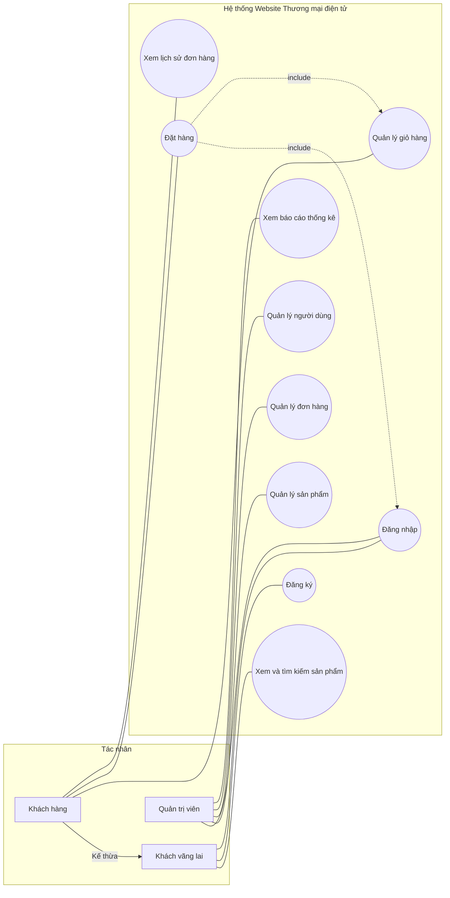

# Tài liệu Sơ đồ Use Case & Đặc tả Chức năng

## 1. Sơ đồ Use Case Diagram (Tổng quan)

### Sơ đồ Mermaid (Nguồn)

---

## 2. Đặc tả chi tiết các Use Case chính

### 2.1. Use Case 1: Đăng nhập (Login)

| Mục | Nội dung |
| :--- | :--- |
| **Mã Use Case** | UC-01 |
| **Tên Use Case** | Đăng nhập |
| **Tác nhân** | Khách hàng, Quản trị viên |
| **Mô tả** | Người dùng xác thực thông tin tài khoản để truy cập các tính năng cá nhân hoặc quản trị trên hệ thống. |
| **Tiền điều kiện** | Người dùng đã có tài khoản trên hệ thống và đang ở trang Đăng nhập. |
| **Hậu điều kiện** | Hệ thống xác thực thành công, phân quyền người dùng và chuyển hướng về trang tương ứng (Trang chủ / Trang Quản trị). |

#### Luồng sự kiện chính (Basic Flow)
1. Người dùng truy cập vào trang Đăng nhập.
2. Hệ thống hiển thị biểu mẫu đăng nhập (Yêu cầu nhập Email/Tên đăng nhập và Mật khẩu).
3. Người dùng nhập Email/Tên đăng nhập và Mật khẩu, sau đó nhấn nút **"Đăng nhập"**.
4. Hệ thống kiểm tra và xác thực thông tin đăng nhập trong CSDL.
5. Hệ thống xác thực thành công, tạo phiên đăng nhập (session/token) và chuyển hướng người dùng:
   - **Khách hàng:** Chuyển về trang trước đó hoặc Trang chủ.
   - **Quản trị viên:** Chuyển về Dashboard Quản trị.

#### Luồng sự kiện phụ / Ngoại lệ (Alternative / Exception Flows)
* **4a. Thông tin đăng nhập không hợp lệ (Sai Email/Mật khẩu):**
  1. Hệ thống phát hiện Email hoặc Mật khẩu không chính xác.
  2. Hệ thống hiển thị thông báo lỗi: *"Tên đăng nhập hoặc mật khẩu không chính xác."*
  3. Hệ thống cho phép người dùng nhập lại (Quay lại bước 3).
* **4b. Tài khoản bị khóa:**
  1. Hệ thống kiểm tra thấy trạng thái tài khoản đang ở mức `Disabled` / `Blocked`.
  2. Hệ thống hiển thị thông báo: *"Tài khoản của bạn đã bị khóa. Vui lòng liên hệ hỗ trợ."*
  3. Use case kết thúc.
* **4c. Quên mật khẩu:**
  1. Tại bước 3, người dùng nhấn nút **"Quên mật khẩu"**.
  2. Hệ thống chuyển hướng sang luồng khôi phục mật khẩu qua Email.

---

### 2.2. Use Case 2: Đặt hàng (Place Order)

| Mục | Nội dung |
| :--- | :--- |
| **Mã Use Case** | UC-02 |
| **Tên Use Case** | Đặt hàng |
| **Tác nhân** | Khách hàng |
| **Mô tả** | Khách hàng thực hiện quy trình thanh toán cho các sản phẩm đã chọn trong giỏ hàng. |
| **Tiền điều kiện** | Khách hàng đã đăng nhập và trong giỏ hàng có ít nhất 01 sản phẩm. |
| **Hậu điều kiện** | Đơn hàng được ghi nhận vào hệ thống với trạng thái "Chờ xử lý", số lượng kho của sản phẩm giảm tương ứng, giỏ hàng được làm sạch. |

#### Luồng sự kiện chính (Basic Flow)
1. Khách hàng truy cập vào trang Giỏ hàng và nhấn nút **"Thanh toán"** (Checkout).
2. Hệ thống hiển thị biểu mẫu Đặt hàng gồm:
   - Thông tin người nhận (Họ tên, Số điện thoại, Địa chỉ giao hàng).
   - Danh sách sản phẩm & tổng tiền.
   - Các phương thức thanh toán (COD, Chuyển khoản, Ví điện tử).
3. Khách hàng kiểm tra/chỉnh sửa thông tin giao hàng và lựa chọn phương thức thanh toán.
4. Khách hàng nhấn nút **"Xác nhận đặt hàng"**.
5. Hệ thống kiểm tra tồn kho của từng sản phẩm trong đơn hàng.
6. Hệ thống khởi tạo đơn hàng mới, cập nhật số lượng tồn kho và gửi email xác nhận cho Khách hàng.
7. Hệ thống xóa các sản phẩm đã mua khỏi giỏ hàng và hiển thị trang **"Đặt hàng thành công"** kèm mã đơn hàng.

#### Luồng sự kiện phụ / Ngoại lệ (Alternative / Exception Flows)
* **1a. Khách hàng chưa đăng nhập:**
  1. Hệ thống yêu cầu Khách hàng đăng nhập (gọi **UC-01: Đăng nhập**).
  2. Sau khi đăng nhập thành công, hệ thống chuyển tiếp Khách hàng trở lại bước Thanh toán.
* **5a. Sản phẩm trong giỏ hàng hết hàng hoặc không đủ số lượng:**
  1. Hệ thống phát hiện số lượng tồn kho không đủ đáp ứng.
  2. Hệ thống thông báo lỗi: *"Sản phẩm [Tên sản phẩm] chỉ còn [X] mục trong kho. Vui lòng cập nhật lại giỏ hàng."*
  3. Hệ thống quay lại trang Giỏ hàng để Khách hàng điều chỉnh số lượng.
* **6a. Thanh toán trực tuyến thất bại (nếu chọn Chuyển khoản/Ví điện tử):**
  1. Cổng thanh toán trả về trạng thái giao dịch thất bại.
  2. Hệ thống lưu đơn hàng ở trạng thái *"Chờ thanh toán"*.
  3. Hệ thống hiển thị thông báo lỗi và cung cấp tùy chọn cho phép Khách hàng thử lại hoặc đổi phương thức thanh toán.

---

### 2.3. Use Case 3: Quản lý sản phẩm (Manage Products)

| Mục | Nội dung |
| :--- | :--- |
| **Mã Use Case** | UC-03 |
| **Tên Use Case** | Quản lý sản phẩm |
| **Tác nhân** | Quản trị viên |
| **Mô tả** | Cho phép Quản trị viên thực hiện các thao tác Xem, Thêm, Sửa, Xóa thông tin sản phẩm trong hệ thống. |
| **Tiền điều kiện** | Quản trị viên đã đăng nhập thành công và truy cập vào trang Quản lý sản phẩm. |
| **Hậu điều kiện** | Cơ sở dữ liệu sản phẩm được cập nhật chính xác theo thao tác thực hiện. |

#### Luồng sự kiện chính (Basic Flow)
1. Quản trị viên truy cập vào danh mục **Quản lý sản phẩm**.
2. Hệ thống tải và hiển thị danh sách sản phẩm (gồm hình ảnh, tên, giá, số lượng tồn kho, danh mục, trạng thái).
3. Quản trị viên lựa chọn một trong các thao tác:

   * **Trường hợp A: Thêm sản phẩm mới**
     1. Quản trị viên nhấn nút **"Thêm mới"**.
     2. Hệ thống hiển thị form nhập thông tin sản phẩm.
     3. Quản trị viên nhập thông tin (Tên, Giá, Số lượng, Danh mục, Mô tả, Hình ảnh) và nhấn **"Lưu"**.
     4. Hệ thống kiểm tra dữ liệu, lưu sản phẩm mới vào CSDL và cập nhật danh sách.

   * **Trường hợp B: Cập nhật thông tin sản phẩm**
     1. Quản trị viên chọn sản phẩm cần chỉnh sửa và nhấn nút **"Chỉnh sửa"**.
     2. Hệ thống hiển thị form điền sẵn thông tin hiện tại của sản phẩm.
     3. Quản trị viên sửa đổi các thông tin cần thiết và nhấn **"Cập nhật"**.
     4. Hệ thống lưu các thay đổi vào CSDL và thông báo thành công.

   * **Trường hợp C: Xóa / Ẩn sản phẩm**
     1. Quản trị viên chọn sản phẩm và nhấn nút **"Xóa"**.
     2. Hệ thống hiển thị hộp thoại xác nhận: *"Bạn có chắc chắn muốn xóa sản phẩm này?"*.
     3. Quản trị viên nhấn **"Xác nhận"**.
     4. Hệ thống đổi trạng thái sản phẩm sang *"Đã xóa/Ẩn"* (Soft delete) và cập nhật giao diện.

#### Luồng sự kiện phụ / Ngoại lệ (Alternative / Exception Flows)
* **A3a / B3a. Dữ liệu nhập không hợp lệ (Bỏ trống trường bắt buộc, Giá/Số lượng âm):**
  1. Hệ thống kiểm tra dữ liệu không vượt qua tính hợp lệ (Validation).
  2. Hệ thống đánh dấu đỏ các ô bị lỗi và hiển thị thông báo cụ thể (ví dụ: *"Giá sản phẩm phải lớn hơn 0"*).
  3. Quản trị viên chỉnh sửa dữ liệu lỗi và bấm lưu lại.
* **C3a. Xóa sản phẩm đang nằm trong đơn hàng đang xử lý:**
  1. Hệ thống kiểm tra thấy sản phẩm gắn với các đơn hàng chưa hoàn tất.
  2. Hệ thống từ chối xóa vĩnh viễn và gợi ý chuyển trạng thái sản phẩm sang *"Ngừng kinh doanh"* thay vì xóa.